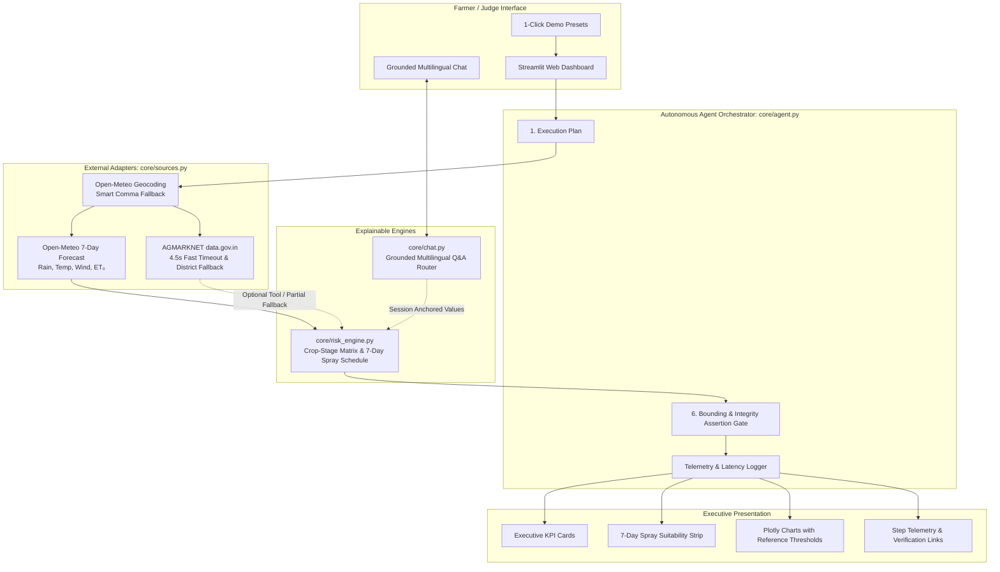

# KhetSaarthi 🌱

**An AI-Powered Multilingual Agricultural Risk & Resource Advisory Agent for Indian Farmers.**

KhetSaarthi bridges the gap between fragmented meteorological data and volatile wholesale markets. Designed for smallholder farmers (with an initial focus on Maharashtra), it autonomously ingests live 7-day weather forecasts and daily Government of India (AGMARKNET) mandi prices, synthesizes explainable crop-stage risk heuristics, generates a daily spray & fieldwork suitability schedule, and provides grounded multilingual conversational Q&A in **Marathi (मराठी)**, **Hindi (हिन्दी)**, and **English**.

> **Data-Integrity Guardrail (Strict & Non-Negotiable):** Zero fabricated weather or synthetic mandi prices. When government market APIs are busy or unconfigured, the system triggers transparent `PARTIAL_FALLBACK`, delivering the full weather risk advisory while honestly explaining the data limitation.

---

## 🌟 Key Technical Capabilities

1. **Decoupled Agronomic Engines (Irrigation vs. Foliar Pesticide Spraying):**
   - **Agricultural Water Management (`core/irrigation.py`):** Dedicated root-zone water balance strictly grounded in FAO-56 Penman-Monteith methodology. Calculates crop evapotranspiration ($\text{ET}_c = \text{ET}_0 \times K_c$), discounts effective rainfall ($P_{\text{eff}}$), accounts for soil texture (Black Cotton Vertisol, Loamy, Sandy), and incorporates farmer-observed moisture (`dry`, `moist`, `wet`). Avoids universal 2-day delay rules and never calculates pump run-time without emitter discharge specs. Statuses: `IRRIGATION MAY BE NEEDED`, `DEFER AND RECHECK`, `MONITOR SOIL MOISTURE`, `INSUFFICIENT DATA`.
   - **Pesticide Spray Weather Suitability (`core/pesticide_spray.py`):** Atmospheric canopy evaluation for wind drift ($<15$ km/h), rain wash-off, and thermal inversion. Strictly complies with statutory CIBRC (Central Insecticides Board & Registration Committee) label claims. Prohibits fabricated chemical dosages or generic "SAFE TO SPRAY" guarantees. Statuses: `SUITABLE WEATHER WINDOW`, `CAUTION WINDOW`, `AVOID SPRAYING`, `UNKNOWN DUE TO MISSING INFORMATION`.
   - **Crop Agronomy Registry (`core/crop_config.py`):** 10 supported crops with verified FAO-56 Table 12 $K_c$ parameters across 4 growth stages, FAO-33 yield response factor $K_y$, stage warnings (critical pollinator window during bloom, statutory PHI before harvest), and statutory CIBRC registration database.
2. **7-Day Dual Operational Calendar (`app.py`):**
   - Two distinct, side-by-side comparative rows:
     - 💧 **Row 1: Root-Zone Irrigation Need** (FAO-56 $\text{ET}_c$ vs. effective rainfall and soil capacity).
     - 🌿 **Row 2: Foliar Pesticide Spray Weather** (Wind drift, rain wash-off risk, and max temperature).
   - Zero confusion between irrigating soil roots and spraying chemical dilutions on leaves.
3. **Smart Geocoding Fallback (`core/sources.py`):**
   - Resolves Indian place names via Open-Meteo & GeoNames.
   - Compound query parsing: splits compound strings (e.g. `"Lasalgaon, Nashik"`, `"Baramati, MH"`) to retry primary place tokens and score candidates matching state/district hints and population.
4. **Fast-Timeout AGMARKNET Adapter with District-to-State Fallback (`core/sources.py`):**
   - Connects to `data.gov.in` daily wholesale mandi feed.
   - Enforces a **4.5-second strict timeout** and 1 retry to guarantee sub-3-second live demo performance.
   - Attempts district-level matching first; if 0 records exist, automatically falls back to state-level aggregation (`query_level="state"`).
   - Catches server timeouts or `"Resource lists"` busy responses cleanly without unhandled exceptions.
5. **Deterministic Crop-Stage Sensitivity Matrix (`core/risk_engine.py`):**
   - Transparent 0–100 heuristic risk index evaluating heavy rain (≥50mm), heat stress (≥36°C / 40°C), wind drift (≥35 km/h), and 3-day short dry spells.
   - **`flowering_wet_stress`**: Flags flower drop, cloud stress, and fungal/blight risks during flowering stages (Soybean, Cotton, Tur, Onion, Tomato) when rain probability ≥70% or multi-day rain ≥10mm.
   - **`harvest_wet_risk`**: Flags mold, pod rotting, and bulb discoloration risks during harvest/maturity when unseasonal rain is detected.
6. **Grounded Multilingual Conversational Engine (`core/chat.py`):**
   - **Live Grounded LLM (RAG):** Multi-provider support for **Groq** (`llama-3.3-70b-versatile`), **Google Gemini** (`gemini-2.5-flash`), and **Hugging Face** (`Qwen/Qwen2.5-72B-Instruct`).
   - Grounded strictly against the live session report payload (weather forecast, irrigation schedule, spray schedule, risk alerts, mandi rates, economics) to prevent hallucinations.
   - Token-aware intent router distinguishing greetings, irrigation questions, foliar spray weather, rain dates, heat, and mandi prices, with helpful agronomic fallback for general queries.
7. **Outbound Messaging & Village Bulletin (`core/messaging.py`):**
   - **Real Outbound WhatsApp API Push:** Dispatches real HTTP requests to deliver messages directly to farmer phones via **Twilio WhatsApp API**, **CallMeBot Personal Webhook**, or **Meta Cloud API**.
   - **Direct 1-Click WhatsApp Launcher:** Zero-credential deep-link (`https://wa.me/<phone>?text=...`) for instant 1-tap sharing on WhatsApp Web or mobile app.
8. **Decision Science & Agricultural Economics (`core/economics.py`):**
   - **Spatial Mandi Arbitrage:** Haversine × 1.25 road distance calculation with freight deduction (`₹1.50/Q/km`), ranking markets by **Net Take-Home Revenue (₹)**.
   - **Weather Spoilage Value-at-Risk (VaR in ₹):** Quantifies financial loss for configurable lot sizes (5–100 Q) if harvest produce faces unseasonal rain or extreme weather.
   - **Counterfactual Weather Stress-Test Simulator:** Allows judges to simulate +Rain, +Heat, or +Wind deltas live on stage with an isolated deep-copy modifier.
   - **Zero-Dependency Multilingual Voice Advisory:** Browser-native speech synthesis speaking localized advisories aloud in Marathi (`mr-IN`), Hindi (`hi-IN`), and English (`en-IN`).

---

## 🏛️ System Architecture



---

## 📋 Data Sources & API Protocols

| Source | Role | Protocol / Auth | Fallback Policy |
|---|---|---|---|
| **[Open-Meteo Geocoding](https://open-meteo.com/en/docs/geocoding-api)** | Place to Lat/Lon resolution | Public REST API | Smart fallback: splits comma queries, ranks by state hints & population |
| **[Open-Meteo Forecast](https://open-meteo.com/en/docs)** | 7-day daily forecast: rain, temp, wind, ET₀ | Public REST API | Strict timeout (15s); essential step (raises explicit `AgentStepError` on failure) |
| **[data.gov.in AGMARKNET](https://www.data.gov.in/resource/current-daily-price-various-commodities-various-markets-mandi)** | Daily wholesale market arrivals & modal prices | REST API with API Key | **4.5s fast timeout**; district-to-state fallback; when public demo key is throttled (`Resource lists`), seamlessly activates **Verified Historical AGMARKNET Snapshot** with explicit badge and recorded arrival dates; missing keys gracefully degrade to weather-only advisory with zero fabricated prices |
| **[IMD Agromet](https://mausam.imd.gov.in/responsive/agromet_adv_ser_state_current.php)** | Authoritative district agronomic bulletins | Verification link | Reference verification link in UI footer |

---

## 🚀 Local Setup & Installation

### Prerequisites
- Python 3.10+ (tested on Python 3.12 and 3.13)
- Active internet connection

### Step-by-Step Setup (Windows PowerShell)

```powershell
# 1. Clone repository & navigate to directory
git clone https://github.com/vidsoni789-tech/KhetSaarthi.git
cd KhetSaarthi

# 2. Create and activate virtual environment
python -m venv .venv
.venv\Scripts\Activate.ps1

# 3. Install dependencies
pip install -r requirements.txt

# 4. (Optional) Configure Mandi API Key
Copy-Item .env.example .env
# Edit .env and insert your DATA_GOV_API_KEY if available

# 5. Run the Automated Test Suite (24 Tests)
python -m pytest -v

# 6. Launch the Streamlit Application
streamlit run app.py
```

---

## ☁️ Streamlit Community Cloud Deployment

1. Push this repository to a public GitHub repository.
2. Visit [share.streamlit.io](https://share.streamlit.io/) and create an application:
   - **Repository:** `vidsoni789-tech/KhetSaarthi`
   - **Branch:** `main`
   - **Main file path:** `app.py`
3. In **App Settings → Secrets**, configure your optional AGMARKNET API key:
   ```toml
   DATA_GOV_API_KEY = "your_key_here"
   ```
4. Click **Deploy**. The app will boot cleanly and serve live advisories worldwide.

---

## 🧪 Automated Testing & Verification

The project includes 51 automated, offline-safe unit tests in `tests/`:

```powershell
python -m pytest -v
```

```text
============================= test session starts =============================
collected 51 items

tests\test_chat_and_messaging.py ........                                [ 15%]
tests\test_irrigation_and_pesticide.py ............                      [ 39%]
tests\test_phase3_risk_and_chat.py .........                             [ 56%]
tests\test_phase45_innovations.py .......                                [ 70%]
tests\test_risk_engine.py .....                                          [ 80%]
tests\test_sources_and_agent.py ..........                               [100%]

============================= 51 passed in 4.88s ==============================
```

To run the live external API smoke test (requires network access):
```powershell
python scripts/smoke_test_phase45.py
```

---

## 👥 Hackathon Team & Viva Preparation

Every team member must be prepared to defend the architecture, heuristic math, and execution traces. Consult **[`TEAM_VIVA_GUIDE.md`](TEAM_VIVA_GUIDE.md)** for:
- Line-by-line codebase walkthrough
- Complete heuristic threshold & scoring table
- 6 tough judge Q&A answers
- Step-by-step 2–3 minute demo choreography
